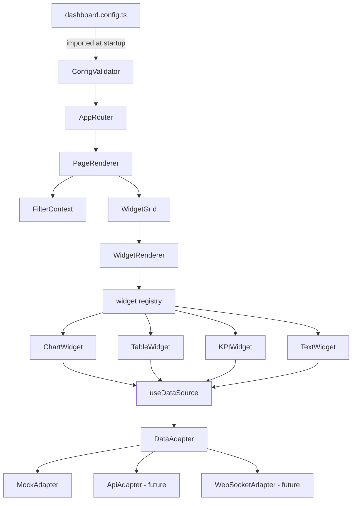
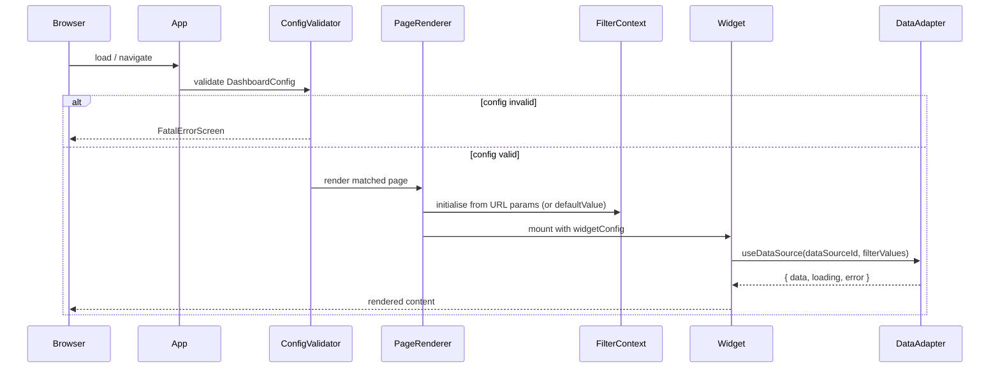
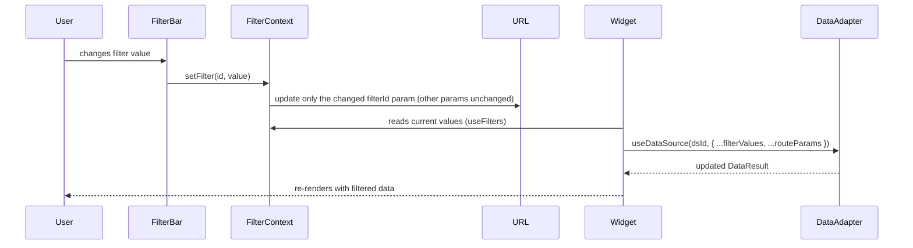

# Design Document

## Overview

Salt Dash is a config-driven single-page dashboard application built with React, TypeScript, and Vite. The entire dashboard structure — pages, widgets, filters, headers, breadcrumbs, and data sources — is declared in a single TypeScript configuration file (`src/config/dashboard.config.ts`). No application code changes are required to add, remove, or rearrange pages and widgets.

The application uses the Salt Design System (`@salt-ds/core`, `@salt-ds/lab`, `@salt-ds/icons`) for all UI primitives, Recharts for chart rendering with Salt colour tokens applied, React Router for client-side routing, `marked` + `DOMPurify` for Markdown rendering, and Vitest for testing. Data is initially served from local JSON mock files, with the architecture designed to accommodate HTTP API and WebSocket data sources in the future with zero impact on widget or filter code.

### Goals

- **Config-first authoring**: Dashboard pages are added, removed, or rearranged purely by editing `dashboard.config.ts`.
- **Widget extensibility**: New widget types are registered in a central registry file; no other files change.
- **Transport agnosticism**: Widgets and filters consume data through a unified `{ data, error, loading }` interface and are unaware of the underlying transport.
- **URL-synced filter state**: Filter state is stored in URL query parameters, enabling bookmarkable and shareable filtered views.
- **Type safety throughout**: The full config schema is a TypeScript type (`DashboardConfig`) with JSDoc on every field, giving authors compile-time feedback.

---

## Architecture

### High-Level Component Hierarchy

```
App (SaltProvider, Router)
└── ConfigValidator
    ├── [Route /] → PageRenderer
    │   ├── BreadcrumbBar
    │   ├── PageHeader
    │   ├── FilterBar (FilterContext.Provider)
    │   └── WidgetGrid
    │       └── WidgetCell[]
    │           └── WidgetRenderer → <ChartWidget | TableWidget | KPIWidget | TextWidget | UnknownWidget>
    └── [Route *] → NotFoundPage
```

### Module Dependency Graph



### Request / Render Lifecycle



---

## Components and Interfaces

### Config Schema (`src/types/config.ts`)

The `DashboardConfig` root type ties all sub-schemas together.

```typescript
/** Root configuration object for the entire Salt Dash application. */
export interface DashboardConfig {
  /** Global UI theme. Passed directly to SaltProvider. Default: Salt DS default theme. */
  theme?: string;
  /** Colour mode for the Salt Provider. Default: "light". */
  mode?: "light" | "dark";
  /** Named data source definitions. Keys are dataSourceIds. */
  dataSources: Record<string, DataSourceConfig>;
  /** Ordered list of dashboard pages. */
  pages: PageConfig[];
}

export type DataSourceConfig =
  | MockDataSourceConfig
  | ApiDataSourceConfig
  | WebSocketDataSourceConfig;

export interface MockDataSourceConfig {
  type: "mock";
  /** Unique identifier for this data source. */
  dataSourceId: string;
  /** Path to the JSON file, relative to the project root. */
  filePath: string;
}

export interface ApiDataSourceConfig {
  type: "api";
  dataSourceId: string;
  /** HTTP endpoint URL. */
  endpoint: string;
}

export interface WebSocketDataSourceConfig {
  type: "websocket";
  dataSourceId: string;
  /** WebSocket URL. */
  url: string;
}

export interface PageConfig {
  /** Unique page identifier. Used internally; not shown in the UI. */
  pageId: string;
  /**
   * URL path for this page. Must begin with "/". Must be unique across all pages.
   * MAY contain named dynamic segments using `:paramName` syntax
   * (e.g. `/orders/:orderId`, `/reports/:reportId/detail`).
   * Each `paramName` must be non-empty and contain only alphanumeric characters and underscores.
   */
  path: string;
  /** Human-readable page title. */
  title: string;
  /** Number of grid columns (1–24). Default: 12. */
  columns?: number;
  /** Optional page header configuration. */
  header?: HeaderConfig;
  /** Optional breadcrumb trail configuration. */
  breadcrumbs?: BreadcrumbItem[];
  /** Optional filter bar configuration. */
  filters?: FilterConfig[];
  /** Ordered list of widgets to render on this page. */
  widgets: WidgetConfig[];
}
```

### Widget Config Types (`src/types/widgets.ts`)

```typescript
export interface BaseWidgetConfig {
  widgetId: string;
  widgetType: string;
  dataSourceId?: string;
  /** Column span (1 – page column count). Default: 6. */
  colSpan?: number;
  /** Row span (1–100). Default: 1. */
  rowSpan?: number;
  /**
   * Names of route params (from the page's dynamic path segments) that should be
   * forwarded to this widget's Data_Adapter as fetch params.
   * e.g. `["orderId"]` for a page with path `/orders/:orderId`.
   */
  routeParams?: string[];
}
```

`FilterConfig` (defined in `src/types/config.ts`) carries the same optional field:

```typescript
export interface FilterConfig {
  filterId: string;
  type: "select" | "multi-select" | "date-range" | "text-search" | "toggle";
  label: string;
  dataSourceId?: string;
  defaultValue?: unknown;
  options?: Array<{ label: string; value: unknown }>;
  /**
   * Names of route params that should be forwarded to this filter's
   * Data_Adapter as fetch params — same semantics as `BaseWidgetConfig.routeParams`.
   */
  routeParams?: string[];
}
```

export interface ChartWidgetConfig extends BaseWidgetConfig {
  widgetType: "chart";
  chartType: "bar" | "line" | "pie" | "area" | "scatter";
  xField?: string;
  yField?: string;
}

export interface TableWidgetConfig extends BaseWidgetConfig {
  widgetType: "table";
  columns: ColumnDef[];
  pageSize?: number;
  resizableColumns?: boolean;
}

export interface KPIWidgetConfig extends BaseWidgetConfig {
  widgetType: "kpi";
  valueField: string;
  label: string;
  trendField?: string;
  prefix?: string;
  suffix?: string;
  target?: number;
}

export interface TextWidgetConfig extends BaseWidgetConfig {
  widgetType: "text";
  content?: string;
}
```

### Widget Registry (`src/widgets/registry.ts`)

```typescript
import type { ComponentType } from "react";
import type { BaseWidgetConfig } from "../types/widgets";

export type WidgetComponent<T extends BaseWidgetConfig = BaseWidgetConfig> =
  ComponentType<{ config: T }>;

const registry = new Map<string, WidgetComponent<any>>();

export function registerWidget<T extends BaseWidgetConfig>(
  widgetType: string,
  component: WidgetComponent<T>
): void {
  registry.set(widgetType, component);
}

export function resolveWidget(widgetType: string): WidgetComponent | undefined {
  return registry.get(widgetType);
}
```

Built-in widgets are registered in `src/widgets/index.ts` by calling `registerWidget` for each type. Adding a new widget requires only creating a new component file and one `registerWidget` call — no other files change.

### Data Adapter (`src/data/DataAdapter.ts`)

```typescript
export interface DataResult<T = unknown> {
  data: T | null;
  loading: boolean;
  error: string | null;
}

export interface DataAdapter {
  fetch(
    dataSourceId: string,
    params?: Record<string, unknown>
  ): Promise<DataResult>;
}
```

The `useDataSource` hook wraps the adapter for React consumption:

```typescript
// src/hooks/useDataSource.ts
export function useDataSource<T = unknown>(
  dataSourceId: string | undefined,
  params?: Record<string, unknown>
): DataResult<T>;
```

Mock, API, and WebSocket adapters each implement `DataAdapter`. The hook selects the correct adapter from the config's `dataSources` map and delegates to it, returning a uniform `DataResult<T>`.

### Page-Scoped Filter Context (`src/hooks/useFilters.ts`)

```typescript
interface FilterContextValue {
  values: Record<string, unknown>;
  setFilter: (filterId: string, value: unknown) => void;
}

export const FilterContext = createContext<FilterContextValue>({...});

export function useFilters(): FilterContextValue;
```

URL query parameters are the single source of truth for filter state. On mount, `FilterContext.Provider` reads URL params via `useSearchParams()` and **only hydrates values for keys that match a `filterId` in the current page's `filters` config array**. All other query params remain in the URL untouched and do not affect `FilterContext.values`. `setFilter` updates only the specific key for the filter being changed; it does not clear or modify unrelated query params. `defaultValue` is used only when neither a URL param nor a user interaction has set a value for that filter.

### Route Params Hook (`src/hooks/useRouteParams.ts`)

```typescript
/**
 * Thin wrapper around React Router's useParams().
 * Returns all named route param values for the current page as
 * Record<string, string | undefined>.
 */
export function useRouteParams(): Record<string, string | undefined>;
```

`PageRenderer` calls `useRouteParams()` once per render and, for each widget on the page, builds the params object passed to `useDataSource` by merging filter values with route param values — but only forwarding the param names listed in the widget's `routeParams` array. If a param name in `routeParams` is absent from the current URL, its value is `undefined`; `useDataSource` and each widget handle `undefined` param values gracefully (loading / empty state, no thrown error).

The same scoping applies to filters: `FilterContext.Provider` uses `useRouteParams` (or `useParams` directly) to forward only the listed `routeParams` names to a filter's `useDataSource` call.

### Action Registry (`src/data/actionRegistry.ts`)

```typescript
type ActionHandler = (...args: unknown[]) => void;
const actions = new Map<string, ActionHandler>();

export function registerAction(actionId: string, handler: ActionHandler): void;
export function dispatchAction(actionId: string, ...args: unknown[]): void;
```

`dispatchAction` logs a warning if `actionId` is not registered and is a no-op.

---

## Data Models

### Mock Data Source JSON Schema

Every mock JSON file must conform to the following schema:

```typescript
interface MockDataFile<T = Record<string, unknown>> {
  /** Required: array of data objects consumed by widgets. */
  data: T[];
  /** Optional metadata for pagination and column hints. */
  meta?: {
    pagination?: {
      total: number;
      page: number;
      pageSize: number;
    };
    columns?: ColumnDescriptor[];
  };
}

interface ColumnDescriptor {
  field: string;
  headerName: string;
  type?: "string" | "number" | "boolean" | "date";
}
```

### Config Validation (`src/config/validateConfig.ts`)

Validation runs synchronously before any route rendering. The validator checks:

- Required fields (`path`, `title`, `pageId`) present on each page entry.
- `path` starts with `/` and is unique across all pages.
- `pageId` is unique across all pages.
- `dataSources` has no duplicate `dataSourceId` values.
- `columns` value is between 1 and 24 if present.
- Each widget's `colSpan` and `rowSpan` are within legal bounds.
- Each widget has a non-empty `widgetId`.

Validation returns a discriminated union:

```typescript
type ValidationResult =
  | { valid: true; config: DashboardConfig }
  | { valid: false; errors: ValidationError[] };

interface ValidationError {
  path: string;   // e.g. "pages[2].path"
  message: string;
}
```

A fatal validation error causes `App` to render `<FatalErrorScreen errors={errors} />` instead of any routes.

Non-fatal per-page or per-widget errors (e.g. duplicate `pageId`, out-of-bounds `colSpan`) are logged to the console and the affected entry is skipped or capped.

### Filter State Shape

```typescript
// Stored in URL query params, keyed by filterId
// e.g. ?status=active&dateRange=2024-01-01,2024-12-31
// Only params whose keys match a filterId in the current page's filters array
// are read into FilterContext; all other query params pass through unchanged.
type FilterState = Record<string, string | string[]>;
```

On page load: URL params → `FilterContext.Provider` reads `useSearchParams()` and hydrates only the entries whose key matches a `filterId` in the current page's `filters` array. All other query params remain in the URL unmodified. `defaultValue` is used only when neither a URL param nor user interaction has set a value for that filter.

### Data Flow for Filter-Driven Widgets



---

## Correctness Properties

*A property is a characteristic or behavior that should hold true across all valid executions of a system — essentially, a formal statement about what the system should do. Properties serve as the bridge between human-readable specifications and machine-verifiable correctness guarantees.*

### Property 1: Config round-trip page registration

*For any* valid `DashboardConfig` with N valid page entries, the set of routes registered by `AppRouter` shall contain exactly the paths defined in those N entries — no more, no fewer.

**Validates: Requirements 1.1, 1.2, 1.7**

### Property 2: Invalid page entries are skipped, not crashed

*For any* `DashboardConfig` where one or more page entries are missing required fields (`path`, `title`, or `pageId`), the app shall register routes only for the valid entries and emit at least one console error per invalid entry.

**Validates: Requirements 1.5**

### Property 3: Duplicate page path / pageId — first-wins invariant

*For any* `DashboardConfig` containing two or more page entries with the same `path` or `pageId`, the router shall render exactly one route for that conflicting value, corresponding to the first occurrence in the array.

**Validates: Requirements 1.6**

### Property 4: Widget colSpan is always capped to page column count

*For any* page config with column count C and any widget config with `colSpan` value S > C, the rendered widget's grid column span shall equal C (not S).

**Validates: Requirements 2.6**

### Property 5: Widget grid order matches config order

*For any* page config containing N widgets, the widgets shall appear in the DOM in the same order as they appear in the `widgets` array of that page config.

**Validates: Requirements 2.4**

### Property 6: DataAdapter returns uniform shape for all source types

*For any* data source type (`mock`, `api`, `websocket`), the value returned by `useDataSource` shall always have exactly the fields `data`, `error`, and `loading`, with no additional transport-specific fields exposed to the caller.

**Validates: Requirements 4.4**

### Property 7: Missing data source yields error state, not a crash

*For any* widget or filter that references a `dataSourceId` not present in the config `dataSources` map, `useDataSource` shall return `{ data: null, loading: false, error: <non-empty string> }`.

**Validates: Requirements 4.3**

### Property 8: Mock data file serialisation round-trip

*For any* valid `MockDataFile` object, serialising it to JSON and reading it back through the MockAdapter shall produce a `DataResult` whose `data` array is deeply equal to the original `data` array.

**Validates: Requirements 4.5, 5.1**

### Property 9: Filter state URL round-trip

*For any* set of filter values applied on a page, serialising those values to URL query parameters and then reloading the page shall restore the `FilterContext` values to the same set, with URL params taking precedence over any `defaultValue`.

**Validates: Requirements 12.11**

### Property 10: Text widget HTML sanitisation removes disallowed elements

*For any* Markdown string that contains one or more disallowed HTML elements (e.g. `<script>`, `<iframe>`, `<object>`, `<embed>`, or `on*` attributes), the HTML produced by the Text widget after parsing and sanitisation shall contain none of those disallowed elements or attributes.

**Validates: Requirements 9.7**

### Property 11: KPI trend indicator sign agrees with value

*For any* `KPIWidgetConfig` with a `trendField` set, and for any data record where the trend value is positive, the rendered indicator shall display an up arrow; where the trend value is negative, the rendered indicator shall display a down arrow; where the trend value is zero, no directional arrow shall be rendered.

**Validates: Requirements 8.3**

### Property 12: Breadcrumb last item is never a link

*For any* breadcrumbs array of length ≥ 1, regardless of whether the last item has an `href` property, the last breadcrumb item shall be rendered as non-navigable plain text.

**Validates: Requirements 11.6**

### Property 13: Duplicate widgetId on a page — first-wins invariant

*For any* page config where two or more widget entries share the same `widgetId`, the page shall render exactly one widget for that id, corresponding to the first occurrence, and shall emit a console warning.

**Validates: Requirements 3.5**

### Property 14: Route param values available to widgets

*For any* page config with a dynamic segment `:paramName` and a widget with `routeParams: ["paramName"]`, navigating to a matching URL shall cause `useDataSource` to receive `{ paramName: "<value from URL>" }` in its `params` argument.

**Validates: Requirements 16.2, 16.3**

### Property 15: Filter context ignores unrelated query params

*For any* page with a `filters` array and a URL containing query params that do not match any `filterId` in that array, the `FilterContext.values` record shall not contain those unrelated keys.

**Validates: Requirements 12.11**

---

## Error Handling

### Config-Level Errors (fatal)

| Condition | Behaviour |
|-----------|-----------|
| `dashboard.config.ts` absent or fails to import | `FatalErrorScreen` shown with file path and import error |
| Config does not satisfy `DashboardConfig` type | `FatalErrorScreen` with list of invalid fields |
| Missing required top-level fields | `FatalErrorScreen` listing field name and reason |

### Config-Level Errors (non-fatal, logged)

| Condition | Behaviour |
|-----------|-----------|
| Page entry missing `path`, `title`, or `pageId` | Console error; entry skipped |
| Duplicate `path` or `pageId` across pages | Console error; first occurrence kept |
| Duplicate `dataSourceId` | Console error; first occurrence kept |
| Widget `colSpan` > page column count | Console warning; colSpan capped |
| Duplicate `widgetId` on same page | Console warning; first occurrence kept |
| Two page entries with ambiguous dynamic paths (e.g. `/orders/:orderId` and `/orders/:id`) | Console warning identifying conflicting paths; first matching page entry rendered |

### Runtime Data Errors

| Condition | Behaviour |
|-----------|-----------|
| `dataSourceId` not found in config | Widget/filter renders error placeholder |
| Mock JSON file missing | Widget/filter renders error placeholder with file path |
| Mock JSON file malformed | Widget/filter renders error placeholder with parse hint |
| API data source (future) unreachable | Widget/filter renders error placeholder |
| `xField` / `yField` not in data | Chart widget renders field-name error message |
| Invalid `chartType` | Chart widget renders unsupported-type error message |
| Text widget `dataSourceId` fetch fails or times out (30 s) | Error message; no partial content |

### Widget-Level Loading States

All widgets use `useDataSource`, which exposes `loading: true` during in-flight requests. Each widget renders a Salt DS skeleton/spinner while `loading` is true and transitions to data or error state once the promise resolves.

### Page-Level Not-Found

Navigation to an unregistered path renders `<NotFoundPage />` built entirely with Salt DS components, with a message and a link back to the first configured page (or `/` if none).

---

## Testing Strategy

### Approach

A dual-layer strategy combining example-based unit tests and property-based tests (PBT) is used. Unit tests cover concrete scenarios, integration points, and UI interaction sequences. Property-based tests verify universal invariants across all valid input spaces.

**PBT library**: [fast-check](https://github.com/dubzzz/fast-check) (TypeScript-native, works with Vitest).

Each property-based test must run a **minimum of 100 iterations** and carry a tag comment linking it back to its design property:

```typescript
// Feature: salt-dash, Property 1: Config round-trip page registration
```

### Unit Tests

**Config validation** (`src/config/__tests__/validateConfig.test.ts`):
- Valid config passes with no errors.
- Missing `path`, `title`, or `pageId` returns specific error messages.
- Duplicate `path` / `pageId` returns error with the conflicting value.
- `columns` outside 1–24 returns error.

**Widget registry** (`src/widgets/__tests__/registry.test.ts`):
- `registerWidget` + `resolveWidget` round-trip returns the same component.
- `resolveWidget` for unknown type returns `undefined`.
- Registering a second time for the same key overwrites the first.

**DataAdapter / useDataSource** (`src/data/__tests__/DataAdapter.test.ts`):
- Unknown `dataSourceId` resolves to `{ data: null, loading: false, error: string }`.
- Mock adapter reads JSON and returns `{ data: [...], loading: false, error: null }`.
- Missing mock file returns `{ data: null, loading: false, error: string }` containing the file path.
- Malformed mock file returns `{ data: null, loading: false, error: string }` mentioning parse failure.

**FilterContext** (`src/hooks/__tests__/useFilters.test.ts`):
- `setFilter` updates both context state and URL search params.
- On mount with URL params present, `values` is initialised from URL (not `defaultValue`).
- On mount with no URL params, `values` falls back to `defaultValue`.

**ChartWidget** (`src/widgets/__tests__/ChartWidget.test.ts`):
- Renders loading state when `loading: true`.
- Renders empty-data message when `data` array is empty.
- Renders error message when `error` is non-null.
- Renders error for invalid `chartType`.
- Renders error when `xField`/`yField` not found in data.
- Does not render `xField`/`yField` error for `pie` charts.

**TableWidget** (`src/widgets/__tests__/TableWidget.test.ts`):
- Renders skeleton rows equal to `pageSize` (or 5) while loading.
- Renders empty-state message when data is empty.
- Renders error state when data source errors.
- Sorting cycles: unsorted → asc → desc → unsorted.

**KPIWidget** (`src/widgets/__tests__/KPIWidget.test.ts`):
- Up arrow rendered for positive trend values.
- Down arrow rendered for negative trend values.
- Placeholder rendered when `valueField` is null/undefined/absent.
- Target status colours applied correctly (above/at/below target).

**TextWidget** (`src/widgets/__tests__/TextWidget.test.ts`):
- Static `content` renders without data fetch.
- `content` takes precedence over `dataSourceId` when both are set.
- Empty/absent `content` with no `dataSourceId` renders empty area (no error).
- `<script>` tags are stripped from rendered output.
- `on*` event attributes stripped from rendered output.

**BreadcrumbBar** (`src/components/__tests__/BreadcrumbBar.test.ts`):
- Last item is always plain text even when `href` is present.
- Item without `href` renders as plain text.
- Item with `href` (non-last) renders as a link.
- Empty array renders no breadcrumb component.
- Item with empty `label` is omitted.

**ActionRegistry** (`src/data/__tests__/actionRegistry.test.ts`):
- Registered handler is called on `dispatchAction`.
- `dispatchAction` for unregistered id emits console warning and does not throw.

### Property-Based Tests

**Property 1 — Config round-trip page registration** (`src/config/__tests__/config.property.test.ts`):
```
// Feature: salt-dash, Property 1: Config round-trip page registration
For any valid DashboardConfig with N valid page entries,
buildRoutes(config).length === N
and buildRoutes(config)[i].path === config.pages[i].path for all i.
```

**Property 2 — Invalid page entries are skipped** (`src/config/__tests__/config.property.test.ts`):
```
// Feature: salt-dash, Property 2: Invalid page entries are skipped, not crashed
For any DashboardConfig with some invalid page entries,
buildRoutes(config) contains no route for any invalid entry.
```

**Property 3 — Duplicate path/pageId first-wins invariant** (`src/config/__tests__/config.property.test.ts`):
```
// Feature: salt-dash, Property 3: Duplicate page path / pageId — first-wins invariant
For any DashboardConfig with duplicate path or pageId,
the resulting route set contains exactly one route per unique path value,
corresponding to the first occurrence in config.pages.
```

**Property 4 — Widget colSpan capped to column count** (`src/components/__tests__/WidgetGrid.property.test.ts`):
```
// Feature: salt-dash, Property 4: Widget colSpan is always capped to page column count
For any page config (columns = C) and widget config (colSpan = S, where S > C),
resolveColSpan(S, C) === C.
```

**Property 5 — Widget grid order matches config order** (`src/components/__tests__/WidgetGrid.property.test.ts`):
```
// Feature: salt-dash, Property 5: Widget grid order matches config order
For any page config with widgets array W,
the rendered widget IDs in the DOM appear in the same order as W.
```

**Property 6 — DataAdapter returns uniform shape** (`src/data/__tests__/DataAdapter.property.test.ts`):
```
// Feature: salt-dash, Property 6: DataAdapter returns uniform shape for all source types
For any DataSourceConfig and any response,
result has exactly the keys { data, error, loading } and no others.
```

**Property 7 — Missing data source yields error state** (`src/data/__tests__/DataAdapter.property.test.ts`):
```
// Feature: salt-dash, Property 7: Missing data source yields error state, not a crash
For any dataSourceId string not present in the dataSources map,
useDataSource returns { data: null, loading: false, error: non-empty string }.
```

**Property 8 — Mock data file serialisation round-trip** (`src/data/__tests__/MockAdapter.property.test.ts`):
```
// Feature: salt-dash, Property 8: Mock data file serialisation round-trip
For any valid MockDataFile, JSON.stringify then MockAdapter.parse
produces DataResult.data deeply equal to the original data array.
```

**Property 9 — Filter state URL round-trip** (`src/hooks/__tests__/useFilters.property.test.ts`):
```
// Feature: salt-dash, Property 9: Filter state URL round-trip
For any set of filter values V,
serialiseToURL(V) |> parseFromURL() === V.
```

**Property 10 — Text widget sanitisation removes disallowed elements** (`src/widgets/__tests__/TextWidget.property.test.ts`):
```
// Feature: salt-dash, Property 10: Text widget HTML sanitisation removes disallowed elements
For any Markdown string containing <script>, <iframe>, <object>, <embed>, or on* attributes,
sanitise(marked(input)) contains none of those elements or attributes.
```

**Property 11 — KPI trend indicator sign** (`src/widgets/__tests__/KPIWidget.property.test.ts`):
```
// Feature: salt-dash, Property 11: KPI trend indicator sign agrees with value
For any numeric trend value v,
renderTrend(v).arrowDirection === (v > 0 ? "up" : v < 0 ? "down" : "none").
```

**Property 12 — Breadcrumb last item is never a link** (`src/components/__tests__/BreadcrumbBar.property.test.ts`):
```
// Feature: salt-dash, Property 12: Breadcrumb last item is never a link
For any breadcrumbs array of length >= 1,
renderBreadcrumbs(items).last.isLink === false.
```

**Property 13 — Duplicate widgetId first-wins invariant** (`src/components/__tests__/WidgetGrid.property.test.ts`):
```
// Feature: salt-dash, Property 13: Duplicate widgetId on a page — first-wins invariant
For any widgets array with duplicate widgetIds,
renderWidgets(widgets) contains exactly one widget per unique widgetId,
corresponding to the first occurrence.
```

**Property 14 — Route param values available to widgets** (`src/hooks/__tests__/useRouteParams.property.test.ts`):
```
// Feature: salt-dash, Property 14: Route param values available to widgets
For any page config with a dynamic segment :paramName and a widget with routeParams: ["paramName"],
resolveWidgetParams(widgetConfig, routeParams, filterValues) contains
{ paramName: routeParams["paramName"] }.
```

**Property 15 — Filter context ignores unrelated query params** (`src/hooks/__tests__/useFilters.property.test.ts`):
```
// Feature: salt-dash, Property 15: Filter context ignores unrelated query params
For any page filters array F and any URL search params map P,
hydrateFilterContext(F, P) contains only keys that exist in F as filterIds,
and no key from P that is absent from F.
```

### Integration Tests

- Full page render with a complete `DashboardConfig` using MSW (or static mock files) to verify end-to-end data flow from config → route → widget → rendered output.
- Filter interaction: changing a filter value updates the URL and causes widget to re-request data with new params.
- `FatalErrorScreen` rendered when config is invalid or absent.
